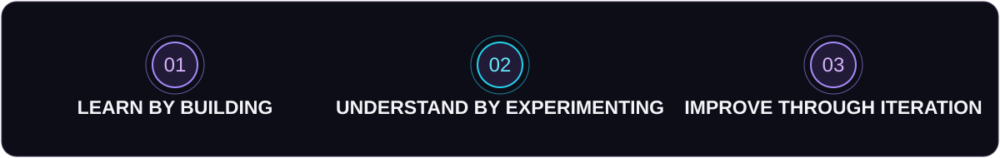
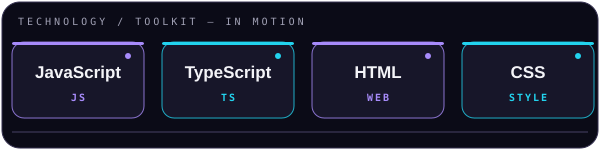
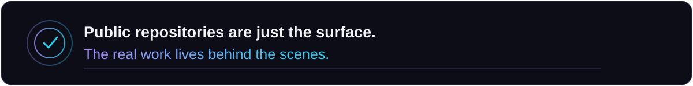
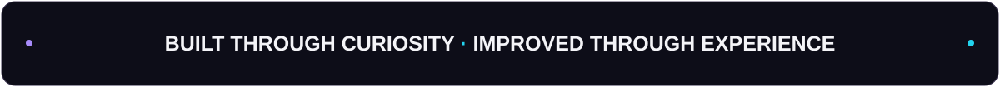

**FULL-STACK DEVELOPER** · Independent builder · Curious by default

---

## About me

I'm **Hashan Chamuditha**, a self-taught independent developer interested in understanding how technology and software really work beneath the surface.

I enjoy building practical projects, experimenting with systems and technology, and learning by working through real problems. I prefer hands-on experience and real-world examples over theory alone. Curiosity drives me to investigate how things work, not just how to use them.

## My mindset

**Learn by building. Understand by experimenting. Improve through iteration.**

I believe useful understanding comes from making things, testing assumptions, finding what breaks, and iterating until the result is better.

## Technical interests

- **Full-stack development** — building complete applications and understanding how their parts fit together.
- **Systems and internals** — exploring how software behaves beneath its interfaces.
- **Reverse engineering** — examining systems to understand their structure and operation.
- **Practical experimentation** — learning through prototypes, debugging, and real-world examples.
- **Scalable software** — working toward platforms and services that can grow reliably.

## Technology arsenal

*The showcase scrolls through the toolkit. These are technologies I work with or explore; this is not a claim of equal proficiency in every one.*

## Learning journey

My current focus is **advanced development** and **Docker**.

I'm working toward stronger full-stack engineering skills, a deeper understanding of application architecture, and the ability to build and operate scalable platforms and services. I learn by applying concepts to practical projects and improving through iteration.

## Featured work

Most of my projects are private, so the public repositories only show part of what I build.

I prefer to share projects when there's something useful and presentable to show. Check my public repositories for the work I have chosen to publish.

<!-- Add public project highlights here when ready. Do not add private repository details. -->

## Future objectives

- Become an advanced Full-Stack Developer.
- Design and build scalable platforms and services.
- Strengthen software architecture and backend engineering skills.
- Use Docker confidently in development and deployment workflows.
- Keep learning by building, experimenting, and improving real projects.

## GitHub activity

## Connect

I'm open to thoughtful conversations about software, development, systems, and practical experimentation.

**Built through curiosity. Improved through experience.**

